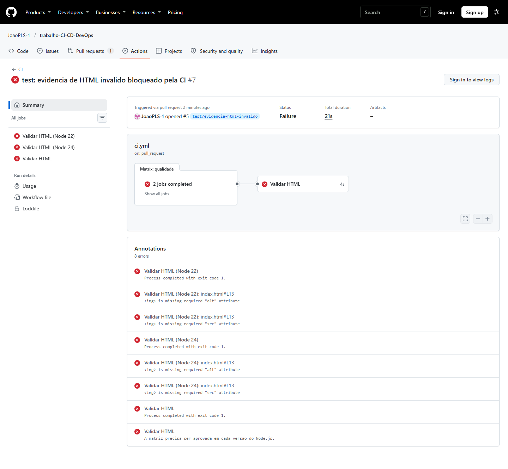
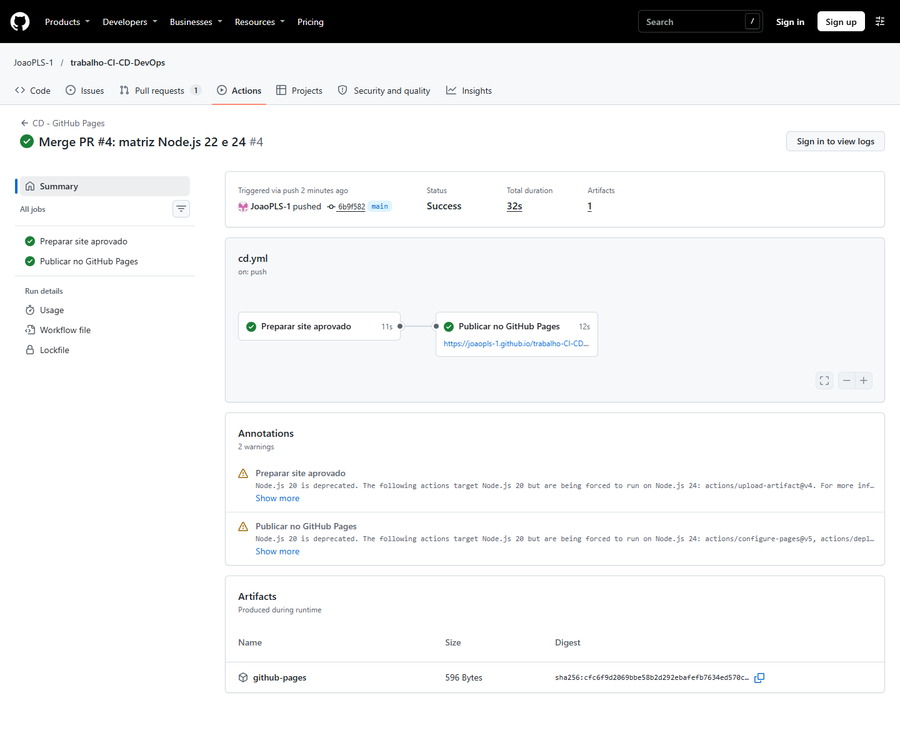

# Evidencias da entrega

## 1. Falha proposital no HTML

- [Execucao real da CI com falha](https://github.com/JoaoPLS-1/trabalho-CI-CD-DevOps/actions/runs/45283248686).
- [PR de demonstracao #5](https://github.com/JoaoPLS-1/trabalho-CI-CD-DevOps/pull/5).
- Commit de demonstracao: `4e7923a`.
- Erro introduzido: tag `` sem os atributos obrigatorios `src` e `alt`.
- Os jobs **Validar HTML (Node 22)** e **Validar HTML (Node 24)** falharam
  na etapa **Executar linter HTML**.
- O check obrigatorio **Validar HTML** tambem reprovou e bloqueou o merge.
- O PR foi fechado sem merge; o HTML invalido nao foi integrado a main.

## 2. Deploy concluido

- [Execucao real do deploy](https://github.com/JoaoPLS-1/trabalho-CI-CD-DevOps/actions/runs/45283227760).
- Commit publicado: `6b9f582`, apos integrar a matriz pelo PR #4.
- Preparacao do artefato e publicacao no GitHub Pages concluidas com sucesso.

## 3. Site publico

[https://joaopls-1.github.io/trabalho-CI-CD-DevOps/](https://joaopls-1.github.io/trabalho-CI-CD-DevOps/)

## 4. Configuracao e acesso

Os workflows ficam em [../../.github/workflows/](../../.github/workflows/).
O linter executa simultaneamente em Node.js 22 e 24, compativeis com
as dependencias atuais do projeto.

O convite para `09116428-collab` foi enviado com permissao de escrita.
A colaboradora precisa aceitar o convite para ativar o acesso.

As imagens sao capturas reais das paginas publicas do GitHub Actions.
Cada arquivo tem menos de 500 KB e permanece fora do artefato publicado.
